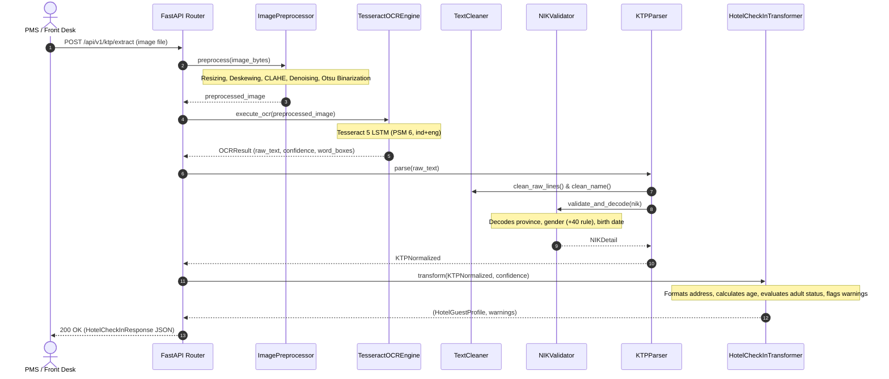

# KTP Hotel Check-In OCR API Documentation

## Overview

The **KTP Hotel Check-In OCR API** is a standalone, production-oriented proof-of-concept (POC) backend service designed to automate hotel guest registration in Indonesia. It accepts images of Indonesian National Identity Cards (*Kartu Tanda Penduduk* - KTP), processes them through a multi-stage computer vision and Tesseract OCR pipeline, parses national identity semantics, and maps them directly into standardized Hotel Property Management System (PMS) guest registration profiles.

---

## Architectural Flow & Separation of Concerns



---

## Base URL & Interactive Documentation

- **Base URL**: `http://localhost:8000`
- **Interactive Swagger UI**: `http://localhost:8000/docs`
- **ReDoc Interactive UI**: `http://localhost:8000/redoc`
- **OpenAPI Schema (JSON)**: `http://localhost:8000/openapi.json`

---

## Endpoints

### 1. Extract KTP from Image Upload

Processes a multipart/form-data upload containing a KTP photograph or scan.

- **Route**: `POST /api/v1/ktp/extract`
- **Content-Type**: `multipart/form-data`
- **Allowed Formats**: `.jpg`, `.jpeg`, `.png`, `.webp`, `.bmp`, `.tiff`
- **Max File Size**: 10 MB (configurable via `MAX_UPLOAD_SIZE_MB`)

#### Request Parameters

| Parameter | Type | In | Required | Description |
|---|---|---|---|---|
| `file` | `binary` | `formData` | Yes | Raw image file of the Indonesian KTP |

#### Example Request (cURL)

```bash
curl -X POST "http://localhost:8000/api/v1/ktp/extract" \
  -H "accept: application/json" \
  -H "Content-Type: multipart/form-data" \
  -F "file=@ktp_sample.jpg;type=image/jpeg"
```

#### Example Response (`200 OK`)

```json
{
  "success": true,
  "guest_profile": {
    "guest_full_name": "Budi Santoso",
    "identity_type": "KTP",
    "identity_number": "3171011505900001",
    "gender": "MALE",
    "date_of_birth": "1990-05-15",
    "place_of_birth": "Jakarta",
    "age": 36,
    "is_adult": true,
    "nationality_code": "ID",
    "nationality": "INDONESIA",
    "full_residential_address": "JL. MH THAMRIN NO. 28, RT 005 / RW 002, Kel. GONDANGDIA, Kec. MENTENG, KOTA/KABUPATEN JAKARTA PUSAT, PROVINSI DKI JAKARTA",
    "occupation": "Karyawan Swasta",
    "marital_status": "Kawin",
    "registration_card_ready": true
  },
  "nik_detail": {
    "nik": "3171011505900001",
    "is_valid_format": true,
    "province_code": "31",
    "province_name": "DKI JAKARTA",
    "city_code": "71",
    "district_code": "01",
    "extracted_birth_date": "1990-05-15",
    "extracted_gender": "MALE",
    "sequence_number": "0001"
  },
  "raw_ktp_data": {
    "provinsi": "PROVINSI DKI JAKARTA",
    "kota_kabupaten": "KOTA/KABUPATEN JAKARTA PUSAT",
    "nik": "3171011505900001",
    "nama": "BUDI SANTOSO",
    "tempat_lahir": "JAKARTA",
    "tanggal_lahir": "15-05-1990",
    "jenis_kelamin": "LAKI-LAKI",
    "golongan_darah": "O",
    "alamat": "JL. MH THAMRIN NO. 28",
    "rt_rw": "005/002",
    "kel_desa": "GONDANGDIA",
    "kecamatan": "MENTENG",
    "agama": "ISLAM",
    "status_perkawinan": "KAWIN",
    "pekerjaan": "KARYAWAN SWASTA",
    "kewarganegaraan": "WNI",
    "berlaku_hingga": "SEUMUR HIDUP"
  },
  "ocr_confidence": 0.8736,
  "warnings": [],
  "processing_time_ms": 328.45
}
```

---

### 2. Extract KTP from Base64 JSON Payload

Useful for mobile apps, single-page web applications (SPAs), or kiosk scanners that capture camera frames in base64.

- **Route**: `POST /api/v1/ktp/extract-base64`
- **Content-Type**: `application/json`

#### Request Body

```json
{
  "image_base64": "data:image/png;base64,iVBORw0KGgoAAAANSUhEUgAA..."
}
```

*Note: The service automatically strips data URI prefixes like `data:image/png;base64,`.*

#### Example Request (cURL)

```bash
curl -X POST "http://localhost:8000/api/v1/ktp/extract-base64" \
  -H "accept: application/json" \
  -H "Content-Type: application/json" \
  -d '{"image_base64": "iVBORw0KGgoAAAANSUhEUgAA..."}'
```

---

### 3. System Health & Diagnostics

- **Route**: `GET /api/v1/health` (also aliased at `GET /health`)
- **Content-Type**: `application/json`

#### Example Response (`200 OK`)

```json
{
  "status": "healthy",
  "version": "1.0.0",
  "tesseract_available": true,
  "tesseract_version": "5.4.0.20240606",
  "available_languages": ["eng", "ind", "osd"]
}
```

---

## Domain Business Logic & Operational Warnings

### 1. Indonesian NIK Decoder
The 16-digit Indonesian NIK structure follows statutory formatting:
- **Digits 1–2**: Kemendagri Province Code (e.g. `31` = DKI Jakarta, `32` = Jawa Barat, `51` = Bali).
- **Digits 3–4**: Regency/City Code.
- **Digits 5–6**: District (Kecamatan) Code.
- **Digits 7–8**: Birth Day.
  - **Male**: `01` – `31`
  - **Female**: Statutory `+40` day addition rule (`41` – `71`). A value of `65` denotes a female born on the 25th of the month.
- **Digits 9–10**: Birth Month (`01` – `12`).
- **Digits 11–12**: 2-digit Birth Year.
- **Digits 13–16**: Birth sequence order.

### 2. Operational Warning Codes

The API inspects data integrity and hotel check-in compliance, returning an array of actionable warnings in the `warnings` field:

| Warning Code | Severity | Description | Action Required |
|---|---|---|---|
| `MINOR_GUEST` | `WARNING` | Guest age is below 18 years old. | Require adult accompaniment or parental consent form. |
| `INVALID_NIK_LENGTH` | `CRITICAL` | Extracted NIK is not 16 digits. | Re-scan document or enter NIK manually. |
| `NIK_DOB_MISMATCH` | `WARNING` | Printed birth date does not match the date encoded in the NIK. | Inspect physical card for potential forgery. |
| `NIK_GENDER_MISMATCH` | `WARNING` | Printed gender does not match gender decoded from NIK (+40 rule). | Cross-check identity card manually. |
| `LOW_OCR_CONFIDENCE` | `WARNING` | Mean OCR confidence score is below 65%. | Review field values for potential character errors. |
| `INCOMPLETE_ADDRESS` | `INFO` | Street name or house number was not detected. | Request full street address from guest. |
| `UNKNOWN_AGE` | `INFO` | Birth date could not be parsed. | Inquire guest's birth date during check-in. |

---

## Error Handling & HTTP Status Codes

All errors return a structured JSON response:

```json
{
  "success": false,
  "error_code": "INVALID_FILE_TYPE",
  "message": "Unsupported file format '.pdf'. Allowed formats: .jpg, .jpeg, .png, .webp, .bmp, .tiff",
  "details": null
}
```

| HTTP Status | Error Code | Cause |
|---|---|---|
| `400 Bad Request` | `IMAGE_PROCESSING_FAILED` | Corrupt image byte stream or undecodable image file. |
| `413 Payload Too Large` | `FILE_TOO_LARGE` | Upload exceeds `MAX_UPLOAD_SIZE_MB` (default: 10MB). |
| `415 Unsupported Media Type` | `INVALID_FILE_TYPE` | Uploaded extension not in allowed list. |
| `422 Unprocessable Entity` | `PROCESSING_ERROR` | Request payload fails Pydantic schema validation. |
| `502 Bad Gateway` | `OCR_ENGINE_ERROR` | Tesseract binary process failure or execution timeout. |
